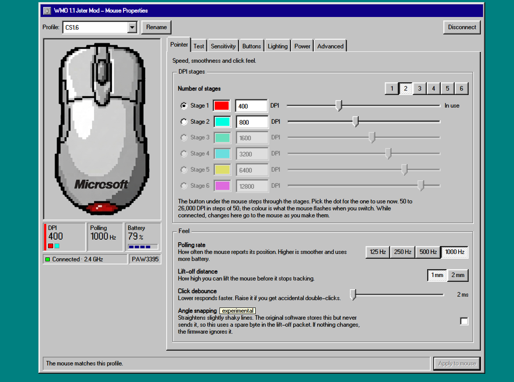
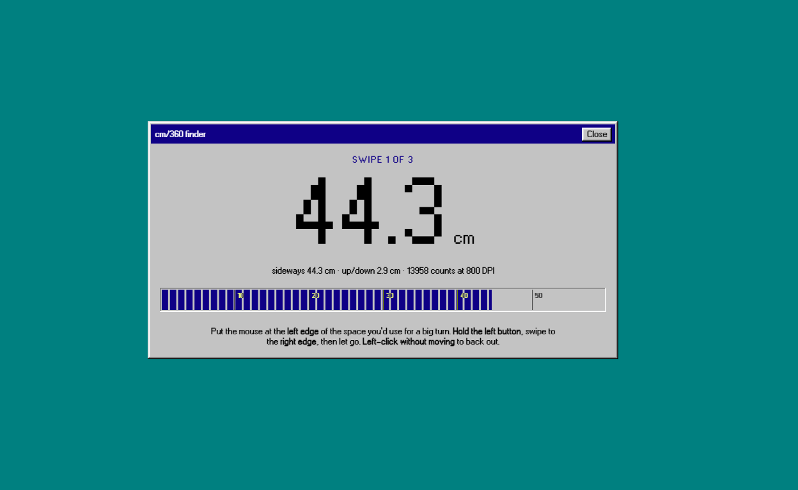
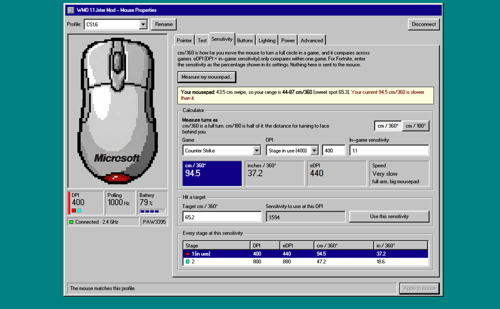

# WMO 1.1 Jster Mod

**A Windows 95–style settings app for the white WMO 1.1 / IntelliMouse-shaped wireless mouse with the PAW3395 sensor.**

I bought this mouse on AliExpress and it's been my favorite mouse in a long time. The classic shape with a modern sensor is great. The software it came with was not great. It was a mystery Chinese `.exe` that VirusTotal flagged as malware. Free malware with every mouse is a little too generous, so I never ran it and built this instead.

It's a single HTML file. No installer, no `.exe`, and nothing phones home. You can read every line of it.

## Which mouse is this?

It was sold on AliExpress as the **"Aofeng 3395 Pro Mouse 2.4g Wireless 26000 Dpi Charging 1000hz"** for about $57. The listing has since been taken down 😭, so here's my old order to help you spot it if it shows up again under another name:

If your mouse is this shape, has a PAW3395 sensor, and connects as `248A:5B2F` (dongle) or `248A:5B2E` (cable), this app should work with it.

## So Nostalgic!! (I was born after 1999)

A classic mouse deserves a classic control panel. The whole thing is drawn as a Windows 95 **Mouse Properties** window on a teal desktop, with beveled buttons, etched group boxes, a pixel font and a pixel-art mouse. Your PC will feel like it's 1995 again, just with a 26,000 DPI sensor.

## What it can do

| Tab | What's on it |
|---|---|
| **Pointer** | 1–6 DPI stages (50–26,000 in steps of 50), a color for each stage, polling rate (125–1000 Hz), lift-off distance (1 or 2 mm), click debounce, and angle snapping (experimental) |
| **Test** | Check your real polling rate, catch double-clicking switches, and draw lines to see angle snapping working |
| **Sensitivity** | cm/360 and eDPI calculator for Counter-Strike, Source games, Quake Live, Halo and Fortnite, plus a "hit this cm/360" helper and a table for every DPI stage |
| **Buttons** | Remap all 6 buttons |
| **Lighting** | Effects, speed, brightness, direction and colors |
| **Power** | Sleep timer, lights off while moving, and wake on motion |
| **Advanced** | Packet log, raw packet sender, resend everything, and factory reset |

It also keeps more than one profile, shows battery, DPI and polling live, and notices when you press the DPI button on the mouse.

### Got the original Microsoft WMO 1.1?

Pick **Original Microsoft WMO 1.1** in the **Mouse** box at the top. The real WMO 1.1 (and the IntelliMouse Optical 1.1) has no settings memory, so nothing gets sent to it. Its 400 DPI is fixed, and its polling rate is decided by your PC. So this mode helps you set things up on the PC and then checks that they worked:

| Tab | What's on it |
|---|---|
| **Overclock** | Pick a target (125, 250, 500 or 1000 Hz) and your system, and get the steps for that rate. Windows uses [hidusbf](https://github.com/LordOfMice/hidusbf); Linux uses [wmo-oc-kmod](https://github.com/YeaSeb/wmo-oc-kmod), with copy-ready commands. The module's `rate=` number is milliseconds, not Hz, so the page writes it out for you. |
| **Test** | The polling checker compares what your mouse really does with your overclock target. The click checker catches worn, double-clicking switches. |
| **Sensitivity** | The same calculator and cm/360 finder, set to 400 DPI. |
| **Motion** | Works out what each Windows pointer-speed notch does at 400 DPI and shows where to turn off acceleration (Windows, GNOME and KDE). Also covers button remapping on the PC. |

500 Hz is the usual safe pick. 1000 Hz works on many WMO 1.1s but not all, so check it on the Test tab. Both tools are third-party drivers that run with full access to your system: hidusbf needs Memory Integrity turned off on Windows 10/11, and wmo-oc-kmod is a kernel module you build yourself. Read what they do before you install them.

### Find your cm/360 by swiping your mousepad

Click **Measure my mousepad...**, hold the left button and swipe from one edge of your pad to the other three times. It reads raw sensor counts, so Windows acceleration doesn't mess it up, then tells you a good cm/360 range for the space you have.

## How to use it

1. Close the original mouse app if it's running (better yet, never install it).
2. Double-click **`Open WMO.cmd`**, or open `WMO1.1_Jster_Mod.html` in **Edge or Chrome**. It needs WebHID, so Firefox and Safari won't work.
3. Click **Connect mouse** and pick the mouse (dongle `248A:5B2F` or cable `248A:5B2E`).
4. Change stuff, then hit **Apply to mouse**. DPI and lighting changes go to the mouse right away.

It works offline. Just download the repo and open the file.

## ⚠️ Disclaimer: this is vibe coded

I made this with an Claude (Fable 5.2). The USB protocol was worked out by reading the original program's code, without ever running it, then tested on my own mouse. So far the status readout and polling rate are confirmed working on real hardware. The other settings are built from that reverse engineering but haven't all been checked on the mouse yet. If something goes weird, **Advanced → Restore factory defaults** is there for you.

Use it at your own risk. It's still less risky than the malware.

Not affiliated with Microsoft or the mouse's maker. The Windows 95 look is based on [95CSS](https://github.com/YoshiMannaert/95CSS) (MIT, © 2025 Yoshi Mannaert), and the pixel font is W95FA by FontsArena. I'm also looking for a Pixel art artist to reaplce this Shitty ai Render of my mouse, Contact me at Trippytopkek420@gmail.com  
